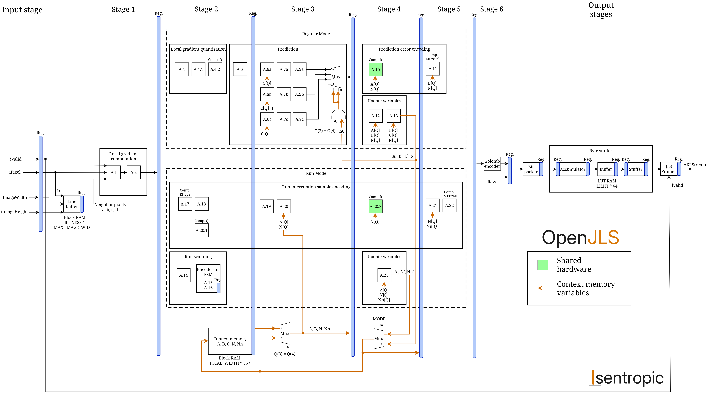
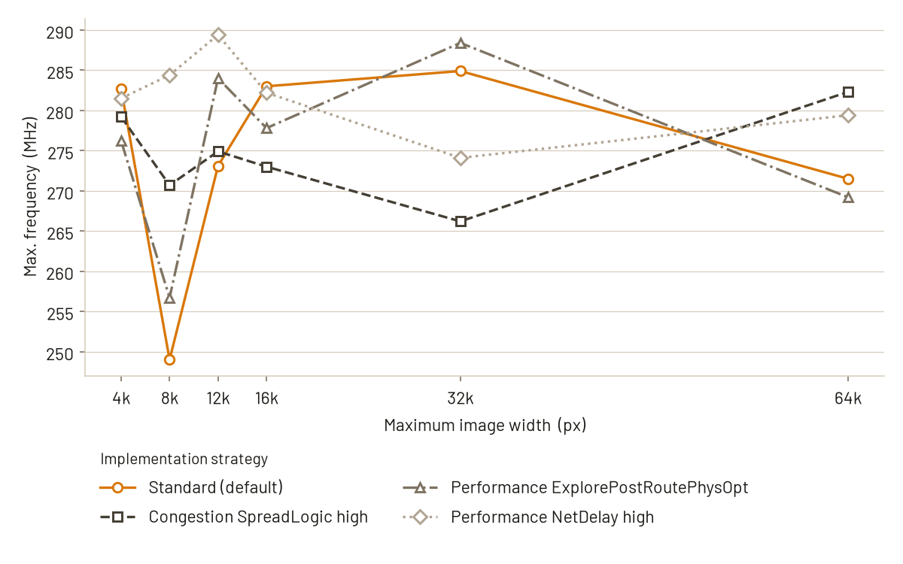
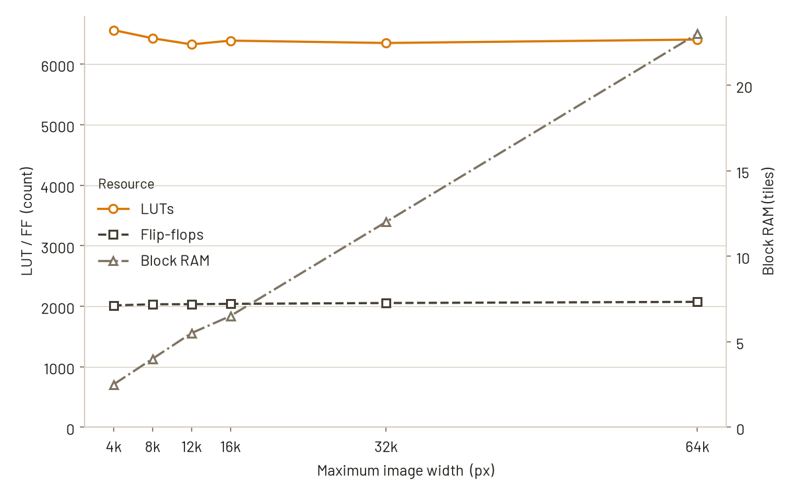
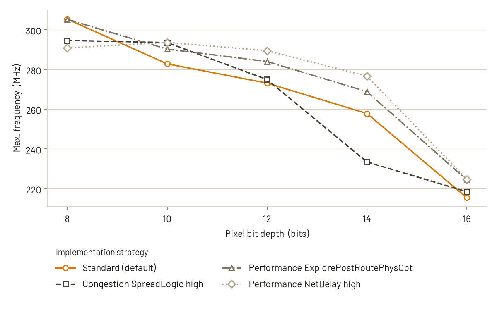
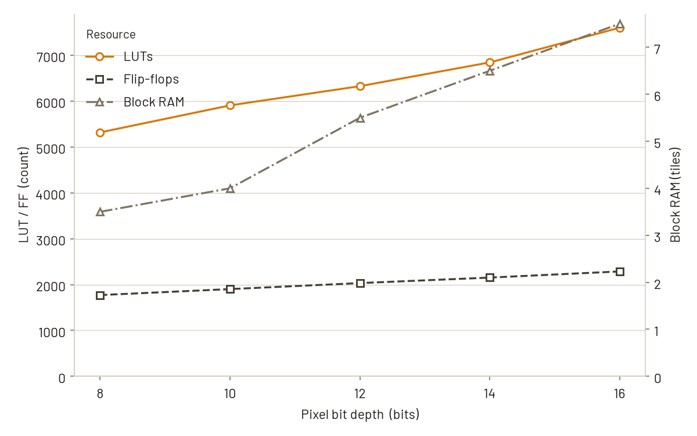

<picture>
  <source media="(prefers-color-scheme: dark)" srcset="Docs/Images/openjls-wordmark-dark.svg">
  
</picture>

OpenJLS is an open, verification-signed JPEG-LS encoder IP core for FPGAs - the open alternative to closed, commercial JPEG-LS cores, for teams who want to audit the RTL and evaluate before they buy.

It implements the JPEG-LS standard (ISO/IEC 14495-1 / ITU-T T.87), a low-complexity lossless image codec reaching ~1.6:1 on natural photographs. Every release is checked byte-exact against an independent reference encoder across 5639 images at 8–16 bits on silicon, 5555 of them also at RTL, and on a post-synthesis subset.

OpenJLS reaches ~280 MHz with 12-bit pixels on a Xilinx UltraScale+ ZU7EG (the MPSoC family used in onboard processors such as the Xiphos Q8), processing one pixel per clock (~280 Mpixel/s) for ~6.3k LUTs and no external memory; 8-bit reaches ~305 MHz and 16-bit ~225 MHz. It handles single-component (grayscale) data, so a multi-band sensor instantiates one compressor per band - resource usage is low enough that all bands run in parallel cheaply.

The RTL is vendor-neutral by construction (plain VHDL-1993 on open-logic memory primitives, which are VHDL-2008) and builds in any synthesis tool; the figures above were characterized on Xilinx.

---

## Resources

- **[Product page](https://isentropic.com.br/openjls)**
- **[Datasheet (PDF)](Docs/datasheet/openjls_datasheet.pdf)**
- **[Verification report](https://isentropic-fpga.github.io/OpenJLS/)**
- **[Interface & integration](#interface)**
- **[Licensing](#licensing)**
- **[Demos](https://github.com/isentropic-fpga/OpenJLS-Demos)**

---

## Features

| | |
|---|---|
| **Standard** | JPEG-LS1 |
| **Compression** | Lossless |
| **Compression ratio** | ~1.6:12 |
| **Components** | Grayscale |
| **Pixel depth** | 8–16 bit3 |
| **Image size** | Up to ~64k × 64k px4 |
| **Throughput** | 1 pixel / clock |
| **Latency** | 14 cycles |
| **fmax** | ~280 MHz5 |
| **Interface** | Ready/valid stream6 |
| **Memory** | On-chip only7 |
| **Resources** | 5.3–7.6k LUT, 1.8–2.3k FF8 |
| **Portability** | Vendor-agnostic VHDL |

1 ISO/IEC 14495-1, ITU-T T.87. 
2 Aggregate over the 240 natural photographs of the test corpus; content-dependent. 
3 Set by the <code>BITNESS</code> generic. 
4 Nominally 65535 × 65535 (64k − 1), the largest value that fits the 2-byte dimension fields. 
5 12-bit, Xilinx <code>xczu7eg-1</code>. 
6 AXI4-Stream and Avalon-ST compatible. 
7 One image row; no external RAM. 
8 Across 8–16 bit, plus block RAM that scales with image width and pixel depth.

---

## Architecture

OpenJLS follows the JPEG-LS encoding pipeline:

1. **Gradient computation** — local gradients from causal pixel neighbors (a, b, c, d)
2. **Context modeling** — gradient quantization into 365 contexts
3. **Prediction** — MED (Median Edge Detector) with per-context bias correction
4. **Encoding** — adaptive Golomb-Rice coding for regular mode, run-length encoding for uniform regions
5. **Bitstream packing** — bit packing, byte stuffing and framing (header and markers) into an ISO/IEC 14495-1 stream

The hardware architecture is based on the optimizations in Mert's [*Key Architectural Optimizations for Hardware Efficient JPEG-LS Encoder*](https://www.researchgate.net/publication/331795298_Key_Architectural_Optimizations_for_Hardware_Efficient_JPEG-LS_Encoder), reworked into a vendor-agnostic, fully pipelined VHDL core.

[`Docs/Requirements.md`](Docs/Requirements.md) is the **source of truth** for the RTL: the code segments and written requirements taken **verbatim from ISO/IEC 14495-1 (ITU-T T.87)**. Source files under [`Sources/`](Sources/) are named after the segments they implement — some combine several, e.g. `A6_A7_prediction_error.vhd` — alongside the line buffer, context RAM, byte stuffer and framer.

---

## Interface

The core is a single entity, `openjls_top`, configured by generics and driven through a pixel-in / bitstream-out streaming interface.

### Generics

| Generic | Range | Description |
|---|:--:|---|
| `BITNESS` | 8–16 | Pixel bit depth. |
| `MAX_IMAGE_WIDTH` | 4–65535 | Largest image width supported; sets the on-chip line-buffer depth. |
| `MAX_IMAGE_HEIGHT` | 1–65535 | Largest image height supported. |
| `OUT_WIDTH` | 48–1024 | Output data-bus width in bits (multiple of 8). |

### Ports

The streaming ports use a plain **ready/valid handshake**; the *AXIS* column gives the 1:1 AXI4-Stream signal mapping for that ecosystem (Avalon-ST maps the same way at `readyLatency = 0`).

| Port | Dir | Width | AXIS | Role |
|---|:--:|---|:--:|---|
| `iClk` | in | 1 | — | Clock; whole core is synchronous to its rising edge. |
| `iRst` | in | 1 | — | Synchronous reset, active high. Also latches the image dimensions (see below). |
| `iImageWidth` | in | 16 | — | Image width in pixels (configuration). |
| `iImageHeight` | in | 16 | — | Image height in pixels (configuration). |
| `iValid` | in | 1 | `TVALID` | Input pixel valid. |
| `iPixel` | in | `BITNESS` | `TDATA` | Input pixel. |
| `oReady` | out | 1 | `TREADY` | Input ready. |
| `oData` | out | `OUT_WIDTH` | `TDATA` | Output bitstream beat. |
| `oValid` | out | 1 | `TVALID` | Output valid. |
| `oKeep` | out | `OUT_WIDTH/8` | `TKEEP` | Valid-byte mask on the final beat. |
| `oLast` | out | 1 | `TLAST` | End of image. |
| `iReady` | in | 1 | `TREADY` | Output ready / downstream backpressure. |

### Integration notes

- **Pixel stream** — unsigned pixels in raster scan order, one per `iValid and oReady`; `oReady` drops only under output backpressure.
- **Dimensions** — `MAX_IMAGE_*` generics size the hardware; `iImageWidth`/`iImageHeight` pick each image's size at run time and latch only while `iRst` is high. Reset on a size change; same-size images run back-to-back. `0` or out-of-range selects the maximum.
- **No input end-of-frame** — end-of-image comes from the dimensions; the output marks it with `oLast` and `oKeep`.

Timing, reset sequencing, latency and an instantiation example are in the [datasheet](Docs/datasheet/openjls_datasheet.pdf).

### Xilinx IP cores

Three pre-packaged Vivado IPs:

| IP Catalog name | Interfaces |
|---|---|
| OpenJLS Encoder (Native) | Plain ready/valid |
| OpenJLS Encoder (AXI4-Stream) | AXI-Stream for the data, native pins for control |
| OpenJLS Encoder (AXI4-Stream + AXI4-Lite) | AXI-Stream for the data, AXI-Lite for control |

Add [`Sources/Xilinx/ip_repo/`](Sources/Xilinx/ip_repo/) to the project's IP repositories; the cores appear in the IP Catalog.

#### AXI4-Lite register map

The AXI4-Lite variant replaces the native control pins with a register bank (32-bit registers, word-aligned offsets):

| Offset | Name | Access | Contents |
|---|---|---|---|
| `0x00` | ID | RO | ASCII `"OJLS"` (`0x4F4A4C53`) |
| `0x04` | VERSION | RO | `0x00MMmmpp` (major/minor/patch) |
| `0x08` | CAPS | RO | `[7:0]` `BITNESS`, `[15:8]` output bytes per beat (`OUT_WIDTH`/8) |
| `0x0C` | MAXDIM | RO | `[15:0]` `MAX_IMAGE_WIDTH`, `[31:16]` `MAX_IMAGE_HEIGHT` |
| `0x10` | WIDTH | RW | `[15:0]` image width (clamped on write) |
| `0x14` | HEIGHT | RW | `[15:0]` image height (clamped on write) |
| `0x18` | CTRL | WO | `[0]` APPLY — self-clearing, pulses the core reset |
| `0x1C` | STATUS | RO | `[0]` BUSY (reset pulse active), `[1]` pixel-stream `TREADY` mirror |

Reconfigure by writing WIDTH/HEIGHT and setting CTRL.APPLY: the wrapper resets the core itself and latches the new dimensions, so no separate reset is needed. **APPLY aborts any image in flight — only apply between images**, not during an acquisition. Same-size images need no APPLY. The map ships as a C header, [`Sources/Xilinx/ojls_regs.h`](Sources/Xilinx/ojls_regs.h).

---

## Performance & Resources

Xilinx Zynq UltraScale+ `xczu7eg-fbvb900-1-e` (speed grade −1), Vivado 2025.2. True fmax (over-constrained until timing fails), RTL-only — no floorplanning or vendor primitives. Representative, not guaranteed.

Each configuration is implemented with four Vivado strategies. fmax tables in MHz, best per row in bold; resources from the Default strategy. Reproduce with [`Scripts/run_fmax_sweep.sh`](Scripts/run_fmax_sweep.sh).

### Maximum frequency vs `MAX_IMAGE_WIDTH`

 
Constant: <code>BITNESS</code> = 12 bits

| `MAX_IMAGE_WIDTH` | Default | ExplorePostRoutePhysOpt | NetDelay_high | Congestion_SpreadLogic_high |
|------------------:|--------:|------------------------:|--------------:|----------------------------:|
| 4096 | **282.7** | 276.2 | 281.5 | 279.2 |
| 8192 | 249.0 | 256.7 | **284.4** | 270.7 |
| 12288 | 273.1 | 284.0 | **289.4** | 274.9 |
| 16384 | **283.0** | 277.8 | 282.2 | 273.0 |
| 32768 | 284.9 | **288.4** | 274.1 | 266.2 |
| 65535 | 271.5 | 269.2 | 279.4 | **282.3** |

### Resource usage vs `MAX_IMAGE_WIDTH`

 
Constant: <code>BITNESS</code> = 12 bits

| `MAX_IMAGE_WIDTH` | LUTs | FFs | BRAM tiles |
|------------------:|-----:|----:|-----------:|
| 4096 | 6563 | 2013 | 2.5 |
| 8192 | 6429 | 2032 | 4.0 |
| 12288 | 6327 | 2033 | 5.5 |
| 16384 | 6389 | 2039 | 6.5 |
| 32768 | 6350 | 2053 | 12.0 |
| 65535 | 6407 | 2072 | 23.0 |

### Maximum frequency vs `BITNESS`

 
Constant: <code>MAX_IMAGE_WIDTH</code> = 12288

| `BITNESS` | Default | ExplorePostRoutePhysOpt | NetDelay_high | Congestion_SpreadLogic_high |
|----------:|--------:|------------------------:|--------------:|----------------------------:|
| 8 | **305.3** | 305.2 | 290.8 | 294.6 |
| 10 | 282.8 | 290.2 | **293.6** | 293.5 |
| 12 | 273.1 | 284.0 | **289.4** | 274.9 |
| 14 | 257.8 | 268.8 | **276.6** | 233.4 |
| 16 | 215.4 | 224.4 | **224.7** | 218.4 |

### Resource usage vs `BITNESS`

 
Constant: <code>MAX_IMAGE_WIDTH</code> = 12288

| `BITNESS` | LUTs | FFs | BRAM tiles |
|----------:|-----:|----:|-----------:|
| 8 | 5319 | 1772 | 3.5 |
| 10 | 5908 | 1902 | 4.0 |
| 12 | 6327 | 2033 | 5.5 |
| 14 | 6845 | 2153 | 6.5 |
| 16 | 7601 | 2287 | 7.5 |

---

## Verification

OpenJLS is verified in [NVC](https://www.nickg.me.uk/nvc/) at RTL and gate level, and on hardware. Results are published in the **[verification report](https://isentropic-fpga.github.io/OpenJLS/)**.

| Suite | Status | Test/Cov | Summary |
|---|---|---|---|
| NVC code coverage | info | 99.8% | Statement coverage1 |
| OSVVM suite | PASS | 100% | 115 tests2 |
| Golden model | PASS | 100% | 5555/5555 images3 |
| Post-synth OSVVM | PASS | 100% | Control-plane stress4 |
| Post-synth golden model | PASS | 100% | 167/167 images5 |
| HIL golden model | PASS | 100% | 5639/5639 images6 |

1 Per-DUT-file breakdown. 
2 7,550,769 affirmations (module + top + AXI wrappers). 
3 Byte-exact vs CharLS. 
4 133,862 affirmations on the gate-level netlist. 
5 8-bit images up to 0.05 MP, byte-exact vs CharLS. 
6 Byte-exact vs CharLS on PYNQ-Z2 silicon.

- **OSVVM** — 32 module testbenches against independent T.87 reference models, a top-level control-plane stress test, and AXI wrapper tests, all with requirements tracking.
- **Coverage** — OSVVM functional coverage plus NVC statement coverage.
- **Golden model** — byte-exact against [CharLS](https://github.com/team-charls/charls) and the official ISO/IEC 14495-1 reference vectors.
- **Design contracts** — PSL assertions on the handshakes, checked every run.
- **Post-synthesis** — stress test and a golden subset re-run on the gate-level netlist.
- **Hardware-in-the-loop** — full corpus encoded on a PYNQ-Z2 at depths 8–16, zero mismatches; reproducible via the [EncodeOverEthernet demo](https://github.com/isentropic-fpga/OpenJLS-Demos).

**Golden-model dataset** — 5639 images: 5555 from 4×1 up to 0.5 MP, run in simulation and on hardware, plus 84 full-size originals run on hardware only:

| Source | Set | Images |
|---|---|--:|
| [USC-SIPI](https://sipi.usc.edu/database/) | Aerials, textures, miscellaneous, sequences | 318 |
| [imagecompression.info](http://imagecompression.info/test_images/) | 8-bit and 16-bit natural photographs | 90 |
| Generated stress probes | Boundary, predictor-adversarial, high-entropy and fuzz patterns | 45 |
| Natural derived | Random crops of the 16-bit photographs, rescaled to each depth 9–16 (~300 per depth) | 2402 |
| Generated noise probes | White and 1/f^β (smoothed) noise, random sizes and value ranges, 300 per depth 8–16 | 2700 |
| Full-size originals | Unsliced USC-SIPI and imagecompression.info images over 0.5 MP, hardware only | 84 |

| Bits | Natural | Natural derived | Noise probes | Stress probes | Full-size originals | Total |
|--:|--:|--:|--:|--:|--:|--:|
| 8 | 363 | 0 | 300 | 0 | 69 | 732 |
| 9 | 0 | 300 | 300 | 2 | 0 | 602 |
| 10 | 0 | 301 | 300 | 2 | 0 | 603 |
| 11 | 0 | 300 | 300 | 2 | 0 | 602 |
| 12 | 0 | 300 | 300 | 2 | 0 | 602 |
| 13 | 0 | 300 | 300 | 2 | 0 | 602 |
| 14 | 0 | 301 | 300 | 2 | 0 | 603 |
| 15 | 0 | 300 | 300 | 2 | 0 | 602 |
| 16 | 45 | 300 | 300 | 31 | 15 | 691 |
| **All** | **408** | **2402** | **2700** | **45** | **84** | **5639** |

The public datasets are natural only at 8 and 16 bits. The natural-derived images ([`gen_depth_tiles.py`](Verification/Golden%20model/imageprep/gen_depth_tiles.py)) rescale random 4×1 to 640×384 crops of the 16-bit photographs to each depth 9–16, giving every depth real texture. The noise probes ([`gen_noise_probes.py`](Verification/Golden%20model/imageprep/gen_noise_probes.py)) span incompressible white noise to smooth, run-mode-heavy 1/f^β gradients. The stress probes ([`gen_stress.py`](Verification/Golden%20model/imageprep/gen_stress.py)) cover boundary geometries (4×1 up to 65535×1), MED-adversarial patterns and a tiny-image fuzz batch. All generators are seeded. Images over 0.5 MP are sliced into three full-width strips of up to 64 rows ([`slice_large.py`](Verification/Golden%20model/imageprep/slice_large.py)); their originals run on hardware only.

---

## Demos

End-to-end example projects live in a companion repository, [**OpenJLS-Demos**](https://github.com/isentropic-fpga/OpenJLS-Demos), each pinning the core as a submodule at its verified commit.

- **[EncodeOverEthernet](https://github.com/isentropic-fpga/OpenJLS-Demos/tree/main/EncodeOverEthernet)** — streams raw images to a PYNQ-Z2 over Ethernet, encodes them 100% in the FPGA, and streams the `.jls` files back.

More demos (additional boards and integrations) are planned.

---

## Licensing

OpenJLS is dual-licensed:

- **[GPL v3](LICENSE.md)** — free under GPL v3 terms: distributing a product that contains OpenJLS requires releasing the design under GPL v3.
- **Commercial License** — for use in proprietary/closed-source products without GPL obligations. Contact [Isentropic](https://isentropic.com.br/contact) at contact@isentropic.com.br for pricing and terms.

**Evaluation is unrestricted.** You can clone, simulate, synthesize, and test OpenJLS freely under the GPL. A commercial license is only required when shipping a product.

**Names and logos are not covered by the GPL.** The OpenJLS and Isentropic wordmarks and logos in `Docs/Images/` may be redistributed as part of an unmodified OpenJLS, but the license grant on the code does not extend to them. Forks and derivative works should carry their own name and marks.

---

## Dependencies

**Using the IP** needs only open-logic, committed in-tree. **Running the verification suite** needs the Linux toolchain in the second table; none of it is part of, or distributed with, the IP.

### Base IP

| Component | License | Notes |
|---|---|---|
| [open-logic](https://github.com/open-logic/open-logic) | LGPL-2.1+ with PSI HDL exception | Vendor-agnostic memory and FIFO primitives, written in VHDL-2008. Weak copyleft confined to its own files; the exception explicitly permits distributing FPGA bitstreams under your own terms. |

### Verification

The verification flows are bash-driven and built around the NVC simulator; they run on Linux and are not supported on Windows.
None of the components below are committed to the repository — running [`ThirdParty/fetch_third_party.sh`](ThirdParty/fetch_third_party.sh) materializes them all: vendoring the HDL with its license texts, building CharLS from source, and installing NVC.

| Component | License | Notes |
|---|---|---|
| [NVC](https://www.nickg.me.uk/nvc/) | GPL-3.0 | VHDL simulator for all simulation, coverage, and post-synthesis flows; developed and tested with NVC 1.21. Not vendored — its GPL covers the simulator, not the IP it runs. |
| [CharLS](https://github.com/team-charls/charls) | BSD-3-Clause | JPEG-LS reference encoder for the golden-model cross-check; built from source at a pinned commit by `ThirdParty/fetch_third_party.sh`. |
| [OSVVM](https://github.com/OSVVM/OSVVM) | Apache-2.0 | VHDL verification library used by the testbench suite. |
| [OSVVM-Scripts](https://github.com/OSVVM/OSVVM-Scripts) | Apache-2.0 | Regression and report-generation script flow. |
| [tcllib](https://github.com/tcltk/tcllib) | Tcl/BSD-style | `fileutil` and `yaml` modules required by the report scripts. |

NVC installs through your OS package manager — the script handles Ubuntu and Arch automatically; elsewhere install it manually from the [NVC docs](https://www.nickg.me.uk/nvc/). No dependency imposes copyleft on the OpenJLS sources, so the dual-licensing model above is unaffected. Redistribution must retain the third-party notices and license texts in `ThirdParty/`.

---

## References

- [Key Architectural Optimizations for Hardware Efficient JPEG-LS Encoder](https://www.researchgate.net/publication/331795298_Key_Architectural_Optimizations_for_Hardware_Efficient_JPEG-LS_Encoder) — Y. M. Mert, IEEE (2018). The hardware architecture OpenJLS is based on.
- [ISO/IEC 14495-1](https://www.itu.int/rec/T-REC-T.87) — JPEG-LS standard specification (ITU-T T.87)
- [open-logic](https://github.com/open-logic/open-logic) — Vendor-agnostic VHDL building blocks used in this project
- [OSVVM](https://osvvm.org/) — VHDL verification methodology (constrained-random + functional coverage) used by the testbench suite
- [NVC](https://www.nickg.me.uk/nvc/) — VHDL simulator used for all simulation, coverage, and post-synthesis flows
- [CharLS](https://github.com/team-charls/charls) — JPEG-LS reference codec used as the golden model for conformance

---

## Contact

OpenJLS is developed and maintained by

<a href="https://isentropic.com.br">
  <picture>
    <source media="(prefers-color-scheme: dark)" srcset="Docs/Images/isentropic-wordmark-dark.svg">
    
  </picture>
</a>

For commercial licensing, technical questions, or collaboration inquiries: [isentropic.com.br](https://isentropic.com.br/contact) or contact@isentropic.com.br
